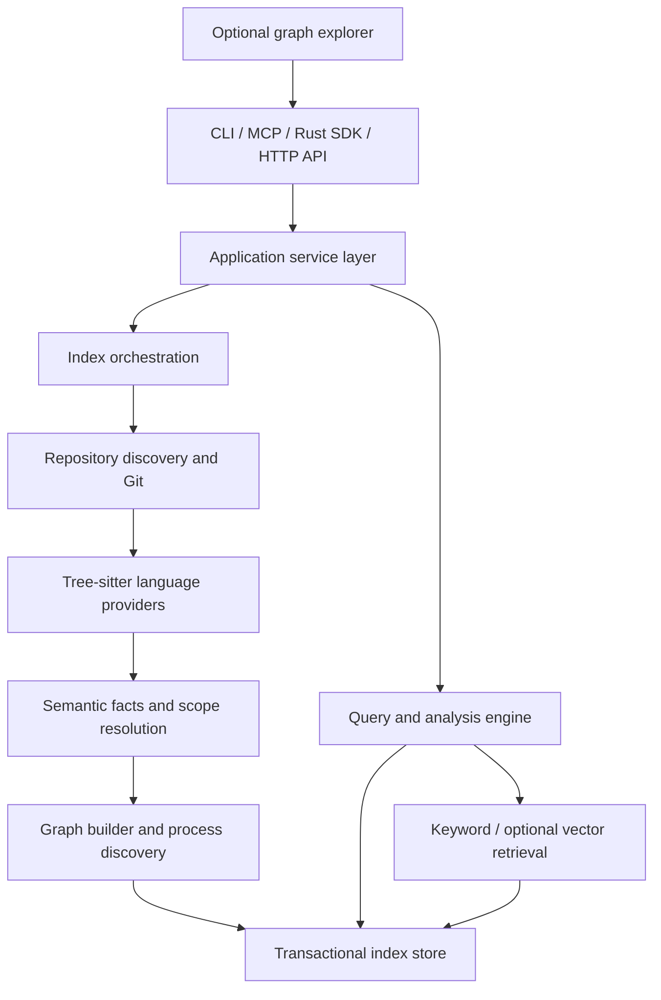

# Kortex — Product and Engineering Specification

**Version:** 1.0.0  
**Status:** Implementation-ready specification  
**Date:** 2026-11-11  
**Product:** `kortex`  
**Primary implementation language:** Rust  
**Primary distribution:** Native CLI, embeddable Rust library, MCP server, optional local HTTP service and web explorer

> **Agent directive:** Implement Kortex as a complete, independent, production-quality Rust application. This document is the authoritative functional and technical specification. Do not stop after scaffolding, mock handlers, or a proof of concept. Complete each milestone, run its acceptance tests, document limitations truthfully, and continue to the next milestone. Never report a feature complete if its end-to-end behavior has not been verified. Do not silently substitute placeholders for implementations.

---

## 1. Executive summary

Kortex is a **local-first, cross-platform code intelligence and architectural knowledge graph engine** designed for human developers, automation, and AI coding agents. It scans repositories, extracts declarations and references, resolves relationships, constructs a durable knowledge graph, and answers high-value questions about code structure, execution paths, dependencies, change impact, API contracts, and tests.

The core is written in Rust. It is usable offline without an account, cloud service, LLM, or embedding provider. It provides consistent functionality through a CLI, MCP server, Rust API, and optional authenticated local HTTP API. A browser-based graph explorer is a separately built optional interface.

**Product positioning:** *Understand the code. Trace the connections. Change with confidence.*

### 1.1 Objectives

1. Provide fast, correct, explainable code intelligence with source citations (file, line, column, commit/index revision).
2. Support reliable cross-file and cross-module resolution, while exposing ambiguity and uncertainty rather than inventing edges.
3. Update indexes incrementally and safely on file or Git changes.
4. Offer AI agents bounded, structured, actionable context through MCP and CLI.
5. Run locally and privately with a single native executable for core functionality.
6. Support multi-repository workspaces and language-aware extensions.
7. Enable impact assessment before code edits and validation after edits.
8. Be safe by default: read-only inspection, minimal permissions, no implicit source uploads.
9. Maintain deterministic indexes, reproducible benchmarks, and migration-safe storage.
10. Permit optional search embeddings, visualization, and advanced analysis without making them mandatory.

### 1.2 Non-goals

- A compiler, build system, debugger, or replacement for language servers.
- A guarantee of perfect static call graph resolution in dynamic languages.
- Automatic code edits without explicit approval.
- Executing arbitrary repository code while indexing.
- Requiring hosted AI models, telemetry, or external authentication.
- Implementing GitNexus-specific internals or binary-compatible database formats.

### 1.3 Reference and intellectual property boundary

GitNexus is a **functional inspiration**, not a codebase to translate. At the time of drafting, its repository describes local code knowledge graphs, hybrid search, CLI/MCP integrations, and impact/trace tools; its package declares **PolyForm Noncommercial 1.0.0**. Kortex must be independently implemented from this specification and public, unprotected concepts. Do not copy GitNexus source code, tests, schemas, documentation prose, icons, or bundled grammars unless the specific materials' licenses and permissions have been reviewed and recorded. A language rewrite does not itself remove copyright or license obligations. Do not claim official compatibility or affiliation.

License for **Kortex itself**: **TBD by project owner before public release**. Evaluate MIT or Apache-2.0 only after dependency and provenance review. Add SPDX identifiers once chosen. Do not assume all grammar packages permit identical redistribution.

References: https://github.com/abhigyanpatwari/GitNexus ; https://github.com/abhigyanpatwari/GitNexus/blob/main/ARCHITECTURE.md ; https://github.com/abhigyanpatwari/GitNexus/blob/main/gitnexus/README.md

---

## 2. Users and use cases

**Personas:** (a) individual developer exploring an unfamiliar repository, (b) coding agent planning and verifying edits, (c) tech lead reviewing architecture, (d) CI pipeline assessing changed code, (e) maintainer navigating a multi-repository monorepo.

**Core workflows:**

1. `kortex index .` builds a graph, metadata, and keyword index without network access.
2. `kortex query "Where is authentication enforced?"` returns ranked symbols/files and evidence.
3. `kortex context src/auth/session.rs:validate_session` returns declaration, callers, callees, types, references, and related tests.
4. `kortex impact src/auth/session.rs:validate_session --direction upstream --depth 3` reports reachable dependents with confidence.
5. `kortex changes --base main --head HEAD` maps Git changes to symbols, impacted routes, and likely tests.
6. `kortex trace --from app::main --to auth::validate_session` returns an evidence-backed path or an explicit not-found/ambiguous result.
7. `kortex serve --mcp stdio` exposes read-only tools to agents.
8. `kortex watch .` maintains an index as files change.
9. `kortex graph --format json` and the optional explorer visualize selected graph neighborhoods.
10. `kortex doctor` diagnoses missing grammars, corrupt indexes, stale metadata, and configuration errors.

---

## 3. Product scope and priorities

| Priority | Capability | Release gate |
|---|---|---|
| P0 | Native CLI, config, repo discovery, ignore rules | M1 |
| P0 | Rust, Python, TypeScript/JavaScript, Go parsing | M2 |
| P0 | Symbol graph, imports, scopes, references, persistence | M2–M3 |
| P0 | Keyword search, context, trace, impact, Git diff | M3–M4 |
| P0 | Incremental indexing and index recovery | M4 |
| P0 | MCP stdio and stable JSON contracts | M5 |
| P0 | Security, regression fixtures, packaging, docs | M6 |
| P1 | Java, C#, C/C++, Ruby, PHP language providers | M7 |
| P1 | Optional vector/hybrid retrieval | M7 |
| P1 | HTTP API, graph explorer, multi-repo UI | M8 |
| P1 | API route mapping, test mapping, architectural rules | M8 |
| P2 | Data-flow/taint analysis, deep interprocedural inference | Later |
| P2 | Semantic rename, automatic refactoring, code writing | Later; separate approval |
| P2 | Remote/shared indexes, collaboration, cloud hosting | Later |

P0 is the **minimum production release**. P1 and P2 are required for the complete long-term product vision but must be tracked separately and must not be misrepresented as implemented in the first release.

---

## 4. Technical architecture



### 4.1 Workspace structure

```text
kortex/
  Cargo.toml                 # workspace; locked dependencies
  Cargo.lock
  rust-toolchain.toml        # pinned stable toolchain
  crates/
    kortex-core/             # domain types, errors, IDs, traits
    kortex-config/           # config validation and migrations
    kortex-repo/             # file discovery, Git, ignore policies
    kortex-parse/            # parser orchestration and grammar loading
    kortex-languages/        # language providers, resolution passes
    kortex-graph/            # graph construction, traversal, impact
    kortex-storage/          # SQLite transactions and schema migrations
    kortex-search/           # FTS, ranking, optional embeddings
    kortex-indexer/          # full/incremental index orchestration
    kortex-analysis/         # context, trace, changes, route/test maps
    kortex-mcp/              # MCP stdio server and schemas
    kortex-http/             # optional HTTP API, feature gated
    kortex-cli/              # executable entrypoint
  web/                       # optional UI; isolated from core builds
  fixtures/                  # small licensed synthetic test repositories
  tests/                     # integration, end-to-end, performance
  benches/                   # criterion and repository benchmarks
  docs/                      # user, developer, security, operations
  packaging/                 # Homebrew, cargo-dist, installers, containers
  .github/workflows/
  AGENTS.md
  README.md
  LICENSE                     # selected by owner
```

### 4.2 Recommended dependencies (verify versions/licenses before implementation)

- Runtime and concurrency: `tokio`, `rayon`, `futures`, `crossbeam-channel` as needed.
- CLI/config: `clap`, `serde`, `serde_json`, `toml`, `schemars`, `directories`.
- Parsing: `tree-sitter`, audited `tree-sitter-*` grammar crates, `streaming-iterator` where needed.
- Git: `gix` or `git2` behind a trait; choose by portability and build footprint.
- Storage: `rusqlite` with bundled SQLite or a documented platform SQLite policy; FTS5 required.
- Graph: `petgraph` for in-memory algorithms; SQLite tables for persistence.
- MCP: `rmcp` if protocol coverage and maintenance pass evaluation; otherwise implement a standards-compliant transport behind an adapter.
- HTTP (optional): `axum`, `tower`, `tower-http`.
- File watching: `notify` and `notify-debouncer-full`.
- Observability: `tracing`, `tracing-subscriber`, `metrics` with opt-in exporters.
- Errors/testing: `thiserror`, `anyhow` at application boundary, `proptest`, `insta`, `criterion`, `tempfile`, `assert_cmd`.
- Search (optional): Tantivy only if FTS5 quality/scale benchmarks justify an additional index; avoid dual index complexity by default.

**Dependency policy:** pin toolchain; commit lockfile; audit CVEs and licenses; generate SBOM; use minimal features; avoid unsafe code except isolated, reviewed FFI; never fetch executable grammars at runtime without explicit opt-in.

### 4.3 Boundaries and invariants

- All transports call the same application services; no duplicated query semantics.
- Parse workers produce immutable per-file semantic facts; global resolution is a separate stage.
- Every persisted graph record belongs to one repository and one committed index generation.
- Query readers see only a fully committed generation, never partial graph state.
- Graph relationships include provenance, resolution status, and confidence.
- No parser may execute build scripts, dependency installation, or arbitrary user code.
- Untrusted repositories cannot override global security policy.
- All results can be serialized to versioned JSON and include stable error codes.

---

## 5. Domain model

### 5.1 Node kinds

`Repository`, `Directory`, `File`, `Module`, `Namespace`, `Package`, `Class`, `Struct`, `Enum`, `Trait`, `Interface`, `Function`, `Method`, `Constructor`, `Field`, `Property`, `Variable`, `Constant`, `TypeAlias`, `Import`, `Export`, `Test`, `Route`, `Process`, `ExternalSymbol`, `UnresolvedReference`.

Each node has: `id`, `repo_id`, `kind`, `language`, `name`, `qualified_name`, `file_path`, `span`, `signature`, `visibility`, `attributes`, `content_hash`, `generation_id`, and optional `doc_comment`. File spans are 1-based for line and column in public APIs; internal Tree-sitter byte offsets are 0-based and explicitly converted. Store both byte offsets and line/column, and specify UTF-8 versus UTF-16 coordinates for editor integration.

### 5.2 Edge kinds

`CONTAINS`, `DECLARES`, `IMPORTS`, `EXPORTS`, `REFERENCES`, `CALLS`, `INHERITS`, `IMPLEMENTS`, `OVERRIDES`, `USES_TYPE`, `READS`, `WRITES`, `HANDLES_ROUTE`, `INVOKES_TOOL`, `TESTS`, `BELONGS_TO_PROCESS`, `DEPENDS_ON`.

Every edge has `id`, `repo_id`, `source_id`, `target_id`, `kind`, `source_span`, `resolution` (`exact|inferred|ambiguous|unresolved`), `confidence` (0–1), `resolver`, `evidence`, and `generation_id`. Unresolved edges must not silently point to a guessed declaration; represent candidates separately.

### 5.3 Stable identity

- Repository ID: hash of normalized canonical repository root plus configurable namespace (do not assume remote URL uniquely identifies local clones).
- File ID: repository ID + normalized repository-relative path.
- Symbol logical ID: repository ID + language + normalized file path + symbol kind + qualified name + disambiguating signature/ordinal.
- Revision-specific ID: logical ID + content/fact fingerprint.
- Expose both `symbol_id` and `symbol_revision_id`; moving/renaming can change logical IDs. Maintain best-effort continuity mappings with explicit confidence, never guarantee identity across arbitrary refactors.
- Normalize paths to `/` in public results; retain native paths internally. Detect case-insensitive collisions on applicable filesystems.

### 5.4 Storage schema (minimum)

```sql
CREATE TABLE schema_migrations(version INTEGER PRIMARY KEY, applied_at TEXT NOT NULL);
CREATE TABLE repositories(id TEXT PRIMARY KEY, root TEXT NOT NULL, created_at TEXT NOT NULL);
CREATE TABLE generations(id TEXT PRIMARY KEY, repo_id TEXT NOT NULL,
  status TEXT NOT NULL CHECK(status IN ('building','committed','failed')),
  git_head TEXT, config_hash TEXT NOT NULL, grammar_hash TEXT NOT NULL,
  started_at TEXT NOT NULL, committed_at TEXT);
CREATE TABLE files(id TEXT, generation_id TEXT, path TEXT NOT NULL,
  language TEXT, content_hash TEXT NOT NULL, size_bytes INTEGER NOT NULL,
  PRIMARY KEY(id,generation_id));
CREATE TABLE nodes(id TEXT, generation_id TEXT, repo_id TEXT NOT NULL,
  kind TEXT NOT NULL, name TEXT NOT NULL, qualified_name TEXT,
  file_path TEXT, start_byte INTEGER, end_byte INTEGER,
  start_line INTEGER, start_col INTEGER, end_line INTEGER, end_col INTEGER,
  attributes_json TEXT NOT NULL DEFAULT '{}',
  PRIMARY KEY(id,generation_id));
CREATE TABLE edges(id TEXT, generation_id TEXT, repo_id TEXT NOT NULL,
  source_id TEXT NOT NULL, target_id TEXT, kind TEXT NOT NULL,
  resolution TEXT NOT NULL, confidence REAL NOT NULL,
  evidence_json TEXT NOT NULL DEFAULT '{}',
  PRIMARY KEY(id,generation_id));
CREATE TABLE symbol_aliases(repo_id TEXT, old_id TEXT, new_id TEXT,
  confidence REAL NOT NULL, generation_id TEXT);
CREATE TABLE index_state(repo_id TEXT PRIMARY KEY, active_generation_id TEXT,
  index_format_version INTEGER NOT NULL);
CREATE INDEX idx_nodes_lookup ON nodes(generation_id,kind,name);
CREATE INDEX idx_nodes_file ON nodes(generation_id,file_path);
CREATE INDEX idx_edges_source ON edges(generation_id,source_id,kind);
CREATE INDEX idx_edges_target ON edges(generation_id,target_id,kind);
```

Production migrations must add foreign keys where appropriate, FTS5 virtual tables, indexes for qualified names and path lookup, and transactional generation cleanup. This SQL is a **minimum conceptual schema**, not a complete migration. Implement active-generation FTS consistency explicitly (FTS virtual tables do not automatically inherit generation filtering).

### 5.5 Persistence decisions

Default: SQLite in WAL mode, `busy_timeout`, foreign keys enabled, bounded read pool and one coordinated writer. Store under `.kortex/` in the repository by default, configurable to a shared cache. The index is disposable and rebuildable; user configuration is not. Exclude `.kortex/` from its own scan. `kortex init` may optionally add `.kortex/` to `.git/info/exclude` after confirmation; never silently edit `.gitignore`.

Use staging generations and atomic pointer switch. On failure retain last good generation, mark failed generation, and garbage-collect safely. Ensure no reader holds deleted generation data. Provide schema migrations and backup before destructive migration. Never allow two writers for the same repository concurrently; use file/DB locks with stale-lock handling.

---

## 6. Indexing pipeline

### 6.1 Discovery

- Accept a repository root, subdirectory, or explicit workspace manifest.
- Respect `.gitignore`, `.ignore`, `.kortexignore`, configurable glob rules, and default exclusions (`.git`, `.kortex`, `node_modules`, `target`, `dist`, `build`, virtual environments, vendor caches).
- Provide `--include`, `--exclude`, `--include-hidden`, `--max-file-size`, `--follow-symlinks` (default false), `--max-files`, and `--languages`.
- Never follow symlinks outside the root by default; prevent loops, path traversal, and duplicate indexing.
- Detect binary files, invalid encodings, generated files, and unsupported languages; report counts and reasons.
- Default file-size cap 2 MiB (configurable); skip large files with diagnostics rather than crashing.
- Read files defensively when files change during indexing; revalidate hash before commit.

### 6.2 Parsing

- Use language-specific Tree-sitter grammars with a shared `LanguageProvider` interface.
- Extract declarations, spans, modifiers, signatures, scopes, imports/exports, type annotations, call sites, property accesses, and references.
- Handle syntax errors gracefully: keep partial facts with diagnostics and reduced confidence.
- Bound parser memory/time; schedule work in a bounded pool; cancellation must release resources.
- Parse each file once per generation unless changed; cache facts by file content hash + parser version + config hash.

Suggested trait:

```rust
pub trait LanguageProvider: Send + Sync {
    fn id(&self) -> LanguageId;
    fn extensions(&self) -> &'static [&'static str];
    fn parse(&self, path: &RepoPath, source: &[u8]) -> Result<ParsedFile, ParseError>;
    fn resolve_local(&self, file: &ParsedFile) -> Vec<ResolutionFact>;
    fn resolve_workspace(&self, ctx: &ResolutionContext<'_>) -> Vec<ResolvedEdge>;
}
```

### 6.3 Resolution

1. Register declarations and lexical scopes.
2. Resolve local bindings and imports/exports.
3. Resolve cross-file/module/package names using language-specific rules.
4. Propagate explicitly supported type facts and method receivers.
5. Resolve calls, inheritance, interface implementation, and references.
6. Assign exact/inferred/ambiguous/unresolved states and provenance.
7. Build dependency and call edges; validate referential integrity.

Do not infer a call merely because a symbol has the same name. Dynamic dispatch, reflection, macros, generated code, conditional compilation, and dependency resolution require explicit uncertainty reporting. Scope resolution must not fabricate dependencies on absent packages.

### 6.4 Language matrix

| Language | P0 extraction | P0 cross-file resolution | Notes |
|---|---|---|---|
| Rust | declarations, `use`, calls, traits, impls | modules/imports, direct calls, trait candidate sets | macros and cfg remain conservative |
| Python | functions, classes, imports, calls | modules, local bindings, qualified calls | dynamic dispatch uncertain |
| TypeScript/JavaScript | functions, classes, imports/exports, calls | ESM/CommonJS basics, relative paths, tsconfig paths | advanced TS type inference is P1 |
| Go | packages, structs, interfaces, calls | imports, receivers, direct calls | interface dispatch candidate sets |
| Java | P1 | P1 | packages and overloads |
| C# | P1 | P1 | namespaces, overloads, partial classes |
| C/C++ | P1 | P1 | preprocessing and compilation database caveats |
| Ruby/PHP | P1 | P1 | dynamic language limitations |

Each language provider must ship fixture-based positive, negative, and ambiguity tests. Clearly report unsupported constructs rather than treating all edges as exact.

### 6.5 Incremental indexing

- File watcher debounces bursts (default 500 ms) and coalesces rename/delete/create events.
- Compare file hashes, parser/config/grammar versions, and Git state.
- Reparse changed files and invalidate dependent resolution facts using reverse import/reference dependency sets.
- Rebuild affected graph subgraphs and search documents, preserving unchanged facts.
- Fall back to full rebuild if invalidation cannot be proven safe, configuration changes, or schema/parser changes require it.
- Commit as a new generation; readers keep using the old committed generation until ready.
- Watch mode must recover from overflow, missed events, atomic-save patterns, and directory renames via reconciliation scans.
- Provide `--full`, `--incremental`, `--verify`, and `--dry-run` controls.

### 6.6 Process and community discovery

P1: derive entry points from recognized routes, CLI mains, event handlers, tests, and framework adapters. Traverse bounded call graphs to identify processes. Group related symbols with a deterministic graph community algorithm only if quality benchmarks justify it. Persist algorithm version/seed. Process labels are heuristic and must expose provenance and confidence.

---

## 7. Search and analysis

### 7.1 Search

P0 supports exact symbol lookup, prefix/qualified-name/path matching, and FTS5 BM25 keyword search over names, signatures, doc comments, and bounded source snippets. Rank with configurable boosts (exact symbol > qualified name > file path > text) and stable tie-breaking. Results must include `why_matched`, scores, source locations, freshness, and resolution status.

P1 hybrid search adds optional local embeddings and explicitly configured remote providers. Embedding models must be opt-in, versioned, reproducible, and cached by content hash. Do not upload code remotely without explicit opt-in and a warning. Combine keyword and vector rankings with reciprocal rank fusion; make ranking weights configurable. Keyword-only mode must remain fully functional.

### 7.2 Query APIs

| Operation | Required behavior |
|---|---|
| `repos` | List indexed repositories, paths, generation, freshness |
| `query` | Ranked search with filters, pagination, token/byte budget |
| `context` | Symbol declaration, owner, callers, callees, references, tests, evidence |
| `impact` | Upstream/downstream reachable dependencies by depth, risk and confidence |
| `trace` | Directed shortest path or bounded alternatives; explicit no-path result |
| `changes` | Git diff to changed symbols and likely affected consumers/tests |
| `graph` | Bounded neighborhood/subgraph export in JSON/DOT/GraphML |
| `status` | Index health, freshness, unsupported files, diagnostics |
| `routes` | P1 route-to-handler and consumer map with framework-specific evidence |
| `check` | P1 configurable architecture constraints with CI-friendly failures |

### 7.3 Impact semantics

Define direction unambiguously: `upstream` means *who depends on the target* (reverse dependency traversal); `downstream` means *what the target depends on* (forward traversal). Default max depth 3, hard cap 10, max nodes 500, timeout 10 seconds; limits configurable within policy. Report direct/indirect reachability separately, edge types traversed, ambiguous paths, confidence aggregation, and truncation. Risk levels are heuristic, never proof of runtime failure.

### 7.4 Change detection

Use Git to read changed paths and hunks for `--base`, `--head`, `--staged`, `--unstaged`, and optionally untracked files. Map changed lines to symbols by spans; if no symbol overlaps, associate file/module. Compute downstream effects via reverse edges and likely tests. Support renames and deletions. Include `index_head`, `diff_base`, `diff_head`, and staleness warning. Never imply working tree matches the indexed generation when it does not.

### 7.5 Query response envelope

```json
{
  "schema_version": "1.0",
  "request_id": "01JEXAMPLE",
  "repo_id": "repo_...",
  "generation_id": "gen_...",
  "index_status": "fresh",
  "partial": false,
  "truncated": false,
  "warnings": [],
  "data": {
    "items": [{
      "symbol_id": "sym_...",
      "kind": "function",
      "qualified_name": "auth::validate_session",
      "location": {"path": "src/auth.rs", "line": 42, "column": 1},
      "confidence": 1.0,
      "evidence": [{"path": "src/auth.rs", "line": 42, "column": 1}]
    }]
  },
  "page": {"next_cursor": null},
  "timing_ms": 12
}
```

All public response objects use versioned JSON Schema, deterministic ordering, explicit nullability, bounded result sizes, and a documented error envelope. Example IDs are illustrative, not exact algorithms.

---

## 8. CLI contract

Executable: `kortex`. All commands support `--help`, `--json` where meaningful, and meaningful nonzero exit codes.

```text
kortex init [path] [--config PATH]
kortex index [path] [--full|--incremental] [--index-only] [--json]
kortex watch [path] [--debounce-ms N]
kortex status [path] [--json]
kortex repos list [--json]
kortex repos remove <repo-id> [--delete-index] [--yes]
kortex query <text> [--repo PATH|ID] [--limit N] [--json]
kortex context <symbol-or-location> [--repo PATH|ID] [--json]
kortex impact <symbol-or-location> [--direction upstream|downstream|both] [--depth N] [--json]
kortex trace --from <symbol> --to <symbol> [--json]
kortex changes [--base REF] [--head REF] [--staged|--unstaged] [--json]
kortex graph <symbol> [--depth N] [--format json|dot|graphml]
kortex mcp [--transport stdio]
kortex serve [--host 127.0.0.1] [--port 7337] [--auth-token-env NAME]
kortex config show|validate|path
kortex doctor [--repair] [--json]
kortex completion bash|zsh|fish|powershell
kortex version [--json]
```

**Compatibility aliases:** `kortex analyze` may alias `kortex index`; never promise compatibility with GitNexus CLI flags. Default human output is concise; `--json` emits machine-readable stdout only and diagnostics to stderr. Stdio MCP must never print logs to stdout.

**Exit codes:** `0` success; `2` invalid usage/config; `3` repo/index not found; `4` ambiguous symbol; `5` stale index when freshness explicitly required; `6` storage/index corruption; `7` partial failure; `8` permission/security refusal; `9` timeout/cancelled; `10` architecture check failed; `1` unexpected error.

### 8.1 Example output

```text
$ kortex impact auth::validate_session --direction upstream --depth 2
Repository: my-app  |  Index: fresh  |  Generation: gen_...
Target: auth::validate_session (src/auth.rs:42)
Direct dependents: 3   Indirect dependents: 7
Likely affected tests: 4   Ambiguous relationships: 1
Run with --json for structured evidence.
```

---

## 9. MCP server specification

- Implement standards-compliant MCP over **stdio** at P0; optionally Streamable HTTP at P1.
- Negotiate protocol versions and capabilities according to the supported MCP SDK version.
- Define tools with JSON Schema inputs/outputs, validation, pagination, limits, cancellation and timeouts.
- Provide MCP resources for repository summaries, graph schema, index status, and optionally symbol references.
- MCP tool names are prefixed `kortex_` to avoid collisions: `kortex_list_repos`, `kortex_query`, `kortex_context`, `kortex_impact`, `kortex_trace`, `kortex_changes`, `kortex_graph`, `kortex_status`.
- P1 adds `kortex_routes`, `kortex_check` and optional search refinements.
- Default tools are read-only. No arbitrary SQL, Cypher, shell execution, source mutation, or remote calls through MCP.
- Inputs must explicitly select repository when multiple repositories could match; never silently choose an arbitrary repository.
- Return evidence-rich, token-bounded results and machine-readable errors; report truncated results.
- For `stdio`, stdout is exclusively protocol traffic, stderr is diagnostics. Support clean shutdown on EOF and signals.
- Document integrations for Pi, Claude Code, Codex, Cursor, VS Code and generic MCP clients using **tested** configurations; do not assume a client's current config schema without checking.

Example generic client configuration (illustrative; exact client format varies):

```json
{
  "mcpServers": {
    "kortex": {
      "command": "kortex",
      "args": ["mcp"]
    }
  }
}
```

### 9.1 Agent workflow guidance

Before modifying a nontrivial feature, an agent should: (1) check index freshness; (2) query for relevant symbols; (3) request context; (4) run impact; (5) plan edits; (6) modify source using its normal editing tools; (7) reindex changed files; (8) validate changed dependencies and tests. Kortex must return enough evidence to support this workflow without claiming to execute tests or edit code itself.

---

## 10. Configuration

Resolution order (highest priority first): CLI flags > `KORTEX_*` environment variables > repo `.kortex.toml` > user config > defaults. Do not let repository config enable network calls, shell execution, or unsafe path access against higher-priority policy.

```toml
schema_version = 1

[repository]
root = "."
follow_symlinks = false
include_hidden = false
max_file_size_bytes = 2097152
exclude = ["**/node_modules/**", "**/target/**", "**/.kortex/**"]

[index]
mode = "incremental"
workers = 0                 # 0 = automatically bounded by CPU/memory
watch_debounce_ms = 500
storage = "repository"     # repository | user-cache

[analysis]
default_depth = 3
max_depth = 10
max_nodes = 500
query_timeout_ms = 10000

[search]
backend = "sqlite_fts5"
embeddings = "disabled"    # disabled | local | remote

[mcp]
read_only = true
max_response_bytes = 262144

[http]
enabled = false
host = "127.0.0.1"
port = 7337
```

Secrets must be supplied via environment variables or OS credential store, never committed in `.kortex.toml`. Validate unknown fields with helpful diagnostics and version migration guidance. Configuration examples must match actual shipped behavior.

---

## 11. HTTP API and graph explorer (P1)

**HTTP:** optional `kortex serve`, loopback binding by default. API prefix `/api/v1`. Endpoints: `/healthz`, `/repos`, `/repos/{id}/status`, `/repos/{id}/query`, `/repos/{id}/symbols/{id}`, `/repos/{id}/impact`, `/repos/{id}/trace`, `/repos/{id}/changes`, `/repos/{id}/graph`. OpenAPI document generated from real handlers/schemas. Use cursor pagination, bounded query complexity, structured errors, request IDs, and cancellation. Non-loopback binding requires explicit authentication configuration and a startup warning; deny by default. Restrict CORS to configured origins. No raw arbitrary filesystem paths in remote requests.

**Explorer:** optional web UI with repository switcher, indexed-file tree, search, interactive graph neighborhood, symbol details, evidence/source location, callers/callees, impact depth controls, changed-code view, status and diagnostics. Use graph virtualization/level-of-detail; do not attempt to render an entire million-node graph at once. Dark/light themes, keyboard navigation, accessible labels, export SVG/PNG/JSON, responsive layouts. The UI consumes public APIs and never bypasses authorization. It must not be required for CLI/MCP functionality.

---

## 12. Security, privacy, and trust

1. **Offline by default:** indexing, parsing, graph building, FTS and MCP require no network.
2. **No telemetry by default:** diagnostics and metrics stay local; any outbound telemetry requires opt-in.
3. **No execution of indexed code:** no package installs, build scripts, tests, hooks, or arbitrary commands during scanning.
4. **No implicit source exfiltration:** remote embedding/LLM provider use requires an explicit setting, provider disclosure and user confirmation where interactive.
5. **Prompt injection resilience:** source files, comments, documentation, and MCP results are untrusted data; never interpret embedded instructions as directives to Kortex or agents.
6. **Filesystem confinement:** canonicalize paths, guard symlinks, reject traversal, enforce configured roots and file-size limits.
7. **Safe defaults:** read-only MCP, loopback HTTP, authentication required for remote binding, bounded queries, no arbitrary graph query language exposed by default.
8. **Resource controls:** cap files, graph expansion, request bytes, worker memory, indexing concurrency, and query time.
9. **Supply chain:** lock dependencies, check vulnerabilities, audit grammar licenses, sign release artifacts, publish checksums and SBOM.
10. **Secrets:** redact tokens and likely credentials from logs; avoid persisting secrets from source beyond essential indexed snippets; document index sensitivity and access controls.
11. **Data lifecycle:** `repos remove` unregisters; optional `--delete-index` deletes owned index only after validation/confirmation. Never delete source code.
12. **Multi-user isolation:** if HTTP/shared hosting is introduced, enforce per-repo authorization on every endpoint and index access.

### 12.1 Threat-model test cases

Malformed ASTs; symlink escape; cyclic symlinks; massive minified files; zip bombs if archive ingestion is later added; path traversal; malicious filenames; concurrent index writers; SQL injection; MCP JSON bombs; query expansion DoS; stale generation races; unauthenticated remote HTTP; prompt injection in comments; accidental code upload; secrets in logs; corrupted SQLite; partial disk-full commits.

---

## 13. Performance and reliability targets

Performance targets are **acceptance goals to benchmark**, not measured claims. Define baseline hardware and fixtures in benchmark reports; do not publish unverified speed comparisons.

| Metric | Initial target | Measurement |
|---|---|---|
| CLI startup (`--version`) | p95 < 100 ms on reference hardware | 100 warm/cold runs |
| Search on 100k symbols | p95 < 150 ms | 1,000 representative queries, warm index |
| Context on 100k symbols | p95 < 200 ms | 1,000 symbol lookups |
| Impact depth 3 | p95 < 500 ms | bounded graph fixtures |
| Single-file incremental update | p95 < 2 s for 10k-file repo | edit-to-committed generation |
| Full index, 10k files | report throughput; optimize against baseline | fixed multi-language fixture |
| Crash recovery | no partially visible generations | injected failures at each commit phase |
| Memory | bounded; publish peak RSS per fixture | repeated index/query benchmarks |

Targets may be revised only with documented hardware, dataset, and rationale. Measure against GitNexus **only when licensing and test methodology permit**, using equivalent workloads, language coverage, and quality metrics; avoid claiming superiority from raw throughput alone. Track graph precision/recall and resolution correctness alongside speed.

### 13.1 Correctness metrics

- Exact symbol extraction precision/recall on labeled fixtures.
- Cross-file resolution precision and recall per language.
- Ambiguity detection and false-positive rate.
- Incremental vs full index graph equivalence (normalized IDs, excluding expected generation metadata).
- Search relevance on curated queries (MRR@10, nDCG@10).
- Impact analysis path validity and false-positive rate.
- Index recovery correctness after crash/disk-full.

---

## 14. Testing and CI

### 14.1 Test pyramid

- Unit: path normalization, IDs, scopes, resolution, ranking, graph algorithms, config and error codes.
- Fixture: each supported language's imports, nested scopes, overloads, aliases, shadowing, recursion, cyclic imports, ambiguous calls, syntax errors.
- Integration: repository scan → graph persistence → query/impact/trace/changes; watcher updates; schema migration; locking.
- Protocol: MCP initialize/list tools/call tools/errors/cancellation, stdout purity; HTTP contract tests when enabled.
- End-to-end: install binary, index synthetic repo, connect test MCP client, execute queries and compare evidence.
- Property/fuzz: parsers, path inputs, graph traversal, malformed JSON, config parser.
- Failure injection: kill during commit, disk full, permission errors, missing grammar, interrupted watcher, corrupt DB.
- Cross-platform: Linux x86_64/aarch64, macOS Apple Silicon/x86_64 as supported, Windows x86_64; document any unsupported targets.

### 14.2 CI required checks

`cargo fmt --all -- --check`, `cargo clippy --workspace --all-targets --all-features -- -D warnings`, `cargo test --workspace`, integration/E2E suite, license and vulnerability audits, SBOM, build and smoke tests for each release platform. Add `cargo llvm-cov` coverage reporting with realistic thresholds (initial core logic target >=80% line coverage; critical storage and security paths >=90%), but never optimize for coverage at the expense of meaningful assertions.

### 14.3 Definition of done for every feature

- Implementation exists in production code; no TODO/mock placeholder in the advertised path.
- User-facing behavior has a documented command/API/tool and example.
- Positive, negative, ambiguous, and failure-path tests pass.
- Public schemas, docs, changelog, and configuration are updated.
- Performance and security impacts are considered.
- CI passes on supported targets; any exceptions are tracked and disclosed.

---

## 15. Delivery plan and milestone acceptance criteria

### M0 — Foundation and governance

**Deliver:** repository workspace, pinned Rust toolchain, lint/test CI, coding standards, architecture decision records, license/provenance policy, CLI skeleton, README, AGENTS.md, release automation skeleton.

**Accept:** clean checkout builds, formats, lints, and tests; `kortex --help` and `kortex version --json` work; license is explicitly chosen or public release blocked.

### M1 — Repository discovery and persistence

**Deliver:** config, ignore rules, Git discovery, file hashing, SQLite schema/migrations, generation transaction manager, registry, diagnostics.

**Accept:** indexes a sample file inventory; respects excludes and symlink confinement; restart preserves active generation; interrupted index preserves last good generation.

### M2 — Parsing and semantic facts

**Deliver:** Tree-sitter providers for Rust, Python, TS/JS, Go; symbols, spans, scopes, imports, references; parser diagnostics and fixtures.

**Accept:** labeled fixtures pass per-language precision/recall checks; malformed files do not crash; extraction spans map to actual source; no execution of indexed code.

### M3 — Graph resolution and search

**Deliver:** language-aware cross-file resolution, nodes/edges, FTS5, `query`, `context`, `graph`, deterministic JSON.

**Accept:** multi-file fixtures resolve known exact calls; ambiguous references stay ambiguous; search ranks exact symbols above incidental text; persisted graph survives restart.

### M4 — Impact, trace, Git changes, incremental updates

**Deliver:** `impact`, `trace`, `changes`, watcher, invalidation graph, atomic generation replacement, staleness warnings.

**Accept:** known call paths and reverse dependencies match fixture expectations; incremental output is equivalent to full rebuild; rapid edits, renames and crash recovery are tested.

### M5 — MCP and agent workflows

**Deliver:** MCP stdio, eight core tools, JSON Schemas, pagination, budgets, integration examples, test client.

**Accept:** actual MCP client initializes and calls every tool; no stdout contamination; ambiguous repo/symbol inputs return structured errors; tool results cite file locations.

### M6 — Production hardening and P0 release

**Deliver:** docs, `doctor`, packaging, CI matrices, security tests, benchmark suite, migration and recovery playbooks, release checksums/SBOM.

**Accept:** clean installation and full user journey pass on Windows/macOS/Linux; offline mode verified; no P0 placeholders; performance/correctness reports published; tagged release can be reproduced.

### M7 — Extended languages and hybrid search

**Deliver:** Java/C#/C/C++/Ruby/PHP providers, optional local embeddings, hybrid retrieval, provider opt-in controls.

**Accept:** provider-specific fixtures pass; keyword-only mode remains offline; remote calls are impossible unless explicitly enabled; ranking evaluation shows documented benefit or feature remains experimental.

### M8 — Explorer, HTTP, architectural intelligence

**Deliver:** secure local HTTP API, interactive web explorer, routes, tests, architecture rules and reports.

**Accept:** browser displays bounded graphs and evidence; non-loopback serving refuses to start without authentication; OpenAPI tests pass; route/check analysis reports confidence and supports CI.

### M9 — Advanced roadmap (separately scoped)

Data-flow/taint, safe rename/refactor preview, optional multi-repo linking, richer framework plugins, shared indexes. Each requires its own security review, correctness fixtures and explicit acceptance tests. Do not mark M9 as complete merely because scaffolding exists.

---

## 16. Agent execution instructions

**Mission:** Build Kortex end to end according to this specification, producing working, tested software rather than a design-only response.

1. Inspect the working directory and existing files. Preserve user work; do not overwrite unrelated changes.
2. Create `docs/IMPLEMENTATION_PLAN.md` mapping every requirement to a milestone, implementation file(s), tests and status (`not_started`, `in_progress`, `blocked`, `verified`).
3. Create `docs/DECISIONS.md` for architecture decisions, alternatives and rationale.
4. Implement milestones in order, completing a vertical slice (CLI → core → storage → test) before adding more abstractions.
5. Run format/lint/tests after each significant change and fix failures before continuing.
6. Implement actual parsers, graph edges, storage and MCP tools; do not ship stubs that return synthetic success.
7. Use small synthetic fixtures with known expected graph facts; add regression fixtures for each discovered bug.
8. Validate functionality with executable CLI and MCP E2E scenarios, not only unit tests.
9. Maintain `docs/IMPLEMENTATION_PLAN.md` and `docs/TEST_RESULTS.md` with commands, observed outcomes and remaining gaps.
10. If blocked by unavailable tools, credentials, dependencies or platform capabilities, identify the precise blocker, complete independent work, and report what remains unverified. Do not fabricate results.
11. Prefer straightforward, maintainable Rust over premature optimization. Profile before replacing algorithms.
12. Never copy restricted GitNexus implementation code. Record third-party dependencies and their licenses.
13. Never run destructive operations or enable remote services without explicit user authorization.
14. Do not ask for confirmation on ordinary reversible implementation details already decided here. Escalate only genuine product/legal/security choices.
15. At the end of each milestone, provide a concise evidence-based summary: completed items, tests executed, failures, benchmarks, and next milestone.

### 16.1 Mandatory first implementation tasks

```text
1. Create Rust workspace and crates listed in Section 4.1.
2. Implement CLI parsing, configuration and structured errors.
3. Implement repository discovery and SQLite generation management.
4. Add Rust and Python parsers with real fixture tests.
5. Persist symbols/edges and expose query/context via CLI.
6. Expand to TS/JS and Go, then cross-file resolution.
7. Implement impact/trace/changes, incremental indexing and MCP.
8. Complete packaging, security and performance validation.
9. Continue through P1 scope as resources permit, tracking it separately.
```

### 16.2 Release checklist

- [ ] All P0 CLI commands implemented and documented.
- [ ] Four P0 language providers verified on real and synthetic repositories.
- [ ] Exact/ambiguous/unresolved reference semantics tested.
- [ ] Atomic index generation and crash recovery tested.
- [ ] Incremental vs full rebuild equivalence tested.
- [ ] Search, context, impact, trace and Git changes tested end to end.
- [ ] MCP protocol verified with a real client.
- [ ] No unintended network access in default mode.
- [ ] Path traversal, symlink and resource-limit tests pass.
- [ ] Cross-platform release binaries install and run.
- [ ] Dependency licenses, SBOM and release license approved.
- [ ] Docs, schemas, examples and benchmarks match shipped behavior.
- [ ] Known limitations explicitly documented.

---

## 17. Open decisions requiring owner approval

1. **Kortex license:** MIT, Apache-2.0, dual license or another choice after legal/provenance review.
2. **Embedding policy:** whether remote embedding providers are allowed at all; default remains disabled.
3. **Graph explorer:** preferred frontend stack (suggest TypeScript + React + Cytoscape.js or Sigma.js, independent of Rust core).
4. **Distribution:** GitHub Releases and `cargo install` first; optional Homebrew, Scoop/WinGet, Docker.
5. **Default index placement:** `.kortex/` versus user cache. Proposed default is `.kortex/` for discoverability.
6. **Brand clearance:** search trademarks, crates.io, GitHub namespace and domains before public release; this document does not assert availability.

None of these decisions should prevent implementing the offline Rust core, except that public release must wait for licensing approval.

---

## 18. Documentation deliverables

`README.md`, `docs/GETTING_STARTED.md`, `docs/CLI.md`, `docs/MCP.md`, `docs/CONFIGURATION.md`, `docs/ARCHITECTURE.md`, `docs/GRAPH_SCHEMA.md`, `docs/LANGUAGE_SUPPORT.md`, `docs/SECURITY.md`, `docs/PRIVACY.md`, `docs/PERFORMANCE.md`, `docs/TROUBLESHOOTING.md`, `docs/CONTRIBUTING.md`, `docs/IMPLEMENTATION_PLAN.md`, `docs/TEST_RESULTS.md`, `docs/DECISIONS.md`, `CHANGELOG.md`, `LICENSE` (after approval), and `AGENTS.md`.

Documentation must include complete, verified copy-paste examples, installation steps for Windows/macOS/Linux, MCP client setup, troubleshooting, data deletion, and a clearly versioned feature matrix.

---

## 19. Final acceptance scenario

A reviewer can take a clean machine with a supported operating system, install Kortex, disable network access, index a multi-language fixture repository, find symbols by keyword, inspect exact and ambiguous references, trace a known call path, calculate impact, modify a file, observe a correct incremental update, inspect a Git diff, connect a real MCP client, obtain structured cited results, terminate and restart the application, and confirm the index is intact. The reviewer can then inject an interrupted index and verify that the last committed generation remains readable. All results are backed by automated tests and recorded measurements.

**Kortex is complete at P0 only when this scenario passes and every P0 acceptance criterion is verified.** P1 and P2 features remain separate milestones until independently delivered.

---

## 20. Source notes

The GitNexus repository and documentation were consulted on 2026-11-11 to understand publicly described functionality and licensing, not to copy implementation. Its features and architecture may change. Kortex's specific architecture, API names, storage layout, schemas, acceptance criteria and roadmap are independently proposed here.

- GitNexus: https://github.com/abhigyanpatwari/GitNexus
- GitNexus README: https://github.com/abhigyanpatwari/GitNexus/blob/main/README.md
- GitNexus package manifest (license declaration): https://github.com/abhigyanpatwari/GitNexus/blob/main/gitnexus/package.json
- GitNexus architecture: https://github.com/abhigyanpatwari/GitNexus/blob/main/ARCHITECTURE.md
- Model Context Protocol: https://modelcontextprotocol.io/
- Tree-sitter: https://tree-sitter.github.io/tree-sitter/
- Rust: https://www.rust-lang.org/

